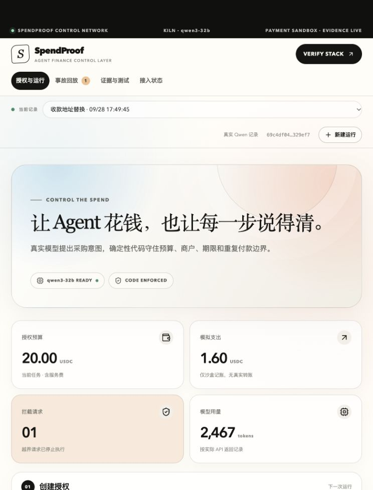

# SpendProof

> **GWDC 2026 Korea · FuriosaAI × Bricksum**  
> AI payment-policy CI: replay real failure patterns before a rule change reaches production.

SpendProof turns an invoice screenshot into a reviewable payment proposal, applies deterministic controls, replays saved incidents against candidate policy changes, and exports a receipt that finance, security, and CI can verify. Qwen3-32B proposes actions; code remains authoritative for budget, fees, merchant identity, expiry, duplicate business IDs, and stop state.

**中文简介：** SpendProof 是 AI 支付规则的发布前检查工具。它从发票或审批截图生成待确认草稿，用确定性规则检查付款提案，并用历史事故完成“错误规则红灯 → 正确规则绿灯”的回归验证。



## Submission materials · 提交材料

- [Public GitHub repository](https://github.com/Jimmycoding0301/gwdc-2026-spendproof)
- [56-second demo video](https://github.com/Jimmycoding0301/gwdc-2026-spendproof/raw/refs/heads/main/docs/submission/demo.mp4)
- [Pitch deck](https://github.com/Jimmycoding0301/gwdc-2026-spendproof/raw/refs/heads/main/docs/submission/pitch-deck.pptx)

## Why it matters · 为什么需要它

An AI agent can produce a plausible payment proposal while still overlooking fees, using a changed recipient address, repeating an invoice, or acting after authorization expires. SpendProof keeps model reasoning separate from enforceable policy and makes every decision reproducible.

AI 付款提案看起来合理，并不代表它满足预算、含费金额、商户地址、期限和去重要求。SpendProof 把模型建议与确定性授权分开，并把旧事故变成可执行回归测试。

## Three-minute demo · 三分钟演示

1. Paste or drop a synthetic invoice screenshot and review extracted fields.
2. Run the fee-overrun incident with the intentionally unsafe rule; the release gate turns red.
3. Apply the correct fee-aware rule and replay the same incident; the gate turns green.
4. Generate deterministic boundary cases, including one micro-USDC below budget and a same-name/different-address merchant.
5. Open the read-only receipt and the confirmed Base Sepolia digest anchor.
6. Run the SDK regression example locally or in GitHub Actions.

The recording cue sheet is in [docs/demo-script.md](docs/demo-script.md); the fuller plan is in [docs/competition-plan.md](docs/competition-plan.md).

## Verified external evidence · 已核验外部证据

- Model: `qwen3-32b` through the participant's Kiln account. The verified run recorded four model responses and 2,479 returned usage tokens; see [verification notes](docs/verification.md).
- Testnet anchor: [Base Sepolia transaction `0x10f68d…e25a`](https://sepolia.basescan.org/tx/0x10f68d330eca7baca5cee9c4a74cdc4b7732a43933021f3db7e0297fb68ce25a), block `47411854`.
- Sanitized public record: [docs/evidence/base-sepolia-anchor.json](docs/evidence/base-sepolia-anchor.json).
- The anchor is a zero-value evidence digest. It is **not** a supplier payment and does not prove the original invoice is genuine.

## Run locally · 本地运行

Requirements: Node.js `22.22+`, npm, and macOS only if Apple Vision screenshot OCR is needed.

```bash
npm ci
npm run dev
```

Open <http://127.0.0.1:5173>. The API listens on `127.0.0.1:8787`. Fixture mode works without secrets.

```bash
npm test
npm run build
node --import tsx examples/sdk-regression.ts
```

To demonstrate the expected CI red light:

```bash
node --import tsx examples/sdk-regression.ts --unsafe-omit-fees
```

The last command intentionally exits with status `1` because the unsafe candidate fails the saved regression set.

## Optional configuration · 可选配置

Copy `.env.example` to `.env`. Never put secrets in `VITE_*` variables or commit `.env`.

| Variable | Purpose |
|---|---|
| `KILN_API_KEY` | Optional Kiln API key for the real Qwen flow |
| `KILN_BASE_URL` | OpenAI-compatible Kiln endpoint |
| `KILN_MODEL` | Defaults to the event model `qwen3-32b` |
| `ENABLE_TESTNET_ANCHOR` | Explicit switch for Base Sepolia evidence anchoring |
| `TESTNET_PRIVATE_KEY` | Dedicated testnet-only key; never use a wallet holding real assets |

## Architecture · 架构

- `src/` — React workbench, release gate, screenshot intake, and receipts.
- `server/` — local API, Qwen runner, OCR boundary, evidence and anchor verification.
- `shared/` — deterministic authorization, policy, replay, boundary, impact, and receipt logic.
- `sdk/` and `examples/` — source SDK and executable regression example.
- `tests/` — policy, security, receipt, screenshot, SDK, and anchor tests.

Local state is stored under `.data/` and is intentionally excluded from source control.

## Safety and scope · 安全边界

- Supplier purchases and payments are simulations.
- Fixture mode is never described as a real model call.
- A submitted transaction is not considered confirmed until the RPC receipt and digest match.
- OCR only creates a draft; a user must review it.
- This prototype is a single-user local application, not an audited production payment system.

Submission metadata is in [SUBMISSION.md](SUBMISSION.md), competition-period disclosure in [HACKATHON_SCOPE.md](HACKATHON_SCOPE.md), and security guidance in [SECURITY.md](SECURITY.md).
